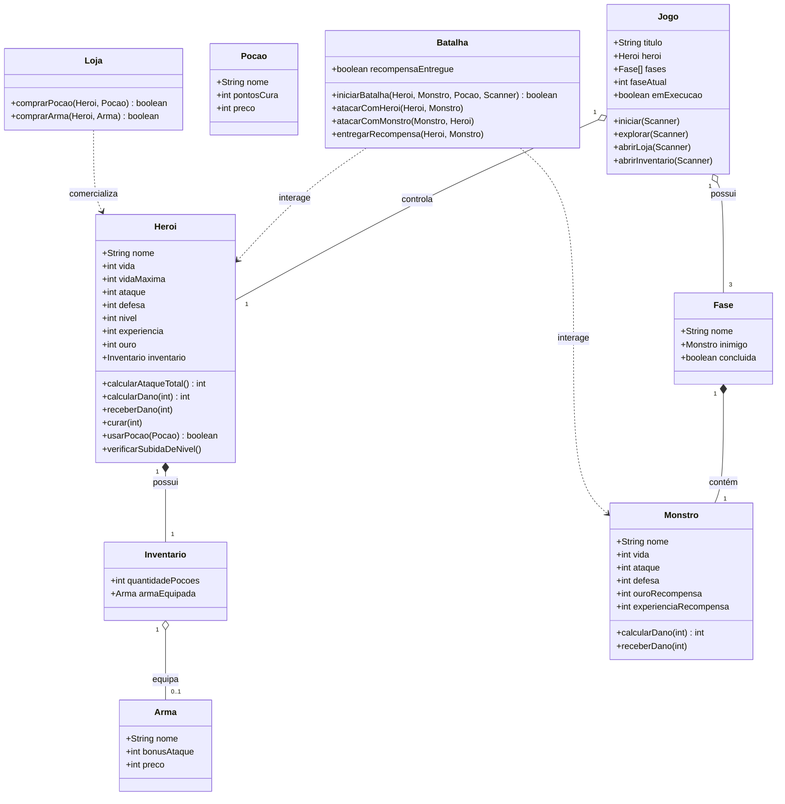

# ⚔️ RPG - Eldoria: A Jornada de Eldoria

[](https://www.oracle.com/java/)
[](https://pt.wikipedia.org/wiki/Programa%C3%A7%C3%A3o_orientada_a_objetos)
[](https://pt.wikipedia.org/wiki/Interface_de_linha_de_comandos)
[](#)
[](#)

> *O outrora pacífico Reino de Eldoria está sob ataque. Criaturas sombrias invadiram as florestas, cavernas e o castelo real. Pegue sua espada, prepare suas poções e derrote o Guardião Sombrio para restaurar a paz!*

---

## 📖 Sobre o Projeto

**RPG - Eldoria** é um jogo de interpretação de papéis em modo texto (CLI - *Command-Line Interface*), com combate por turnos, progressão de personagens, economia de itens e gerenciamento de inventário, desenvolvido em **Java puro**.

O projeto foi construído com forte ênfase didática e prática nos pilares da **Programação Orientada a Objetos (POO)**, demonstrando na prática:
- Abstração e modelagem de entidades do mundo real;
- Composição e associação de classes complexas;
- Gerenciamento de estado e referências de objetos na memória *Heap*;
- Separação de responsabilidades (SRP - *Single Responsibility Principle*);
- Validação robusta de entradas e regras de negócio;
- Testes unitários modulares e uma bateria completa de **Garantia da Qualidade (QA)**.

---

## 🎮 Funcionalidades do Jogo

- 👤 **Criação e Validação do Herói**: Personalização do nome do herói com validações defensivas (rejeição de nomes vazios ou atributos inválidos).
- 🗺️ **Sistema de Fases e Progressão**: Campanha linear dividida em 3 fases com desafios progressivos:
  1. *Floresta Sombria* (Goblin)
  2. *Caverna dos Ossos* (Esqueleto)
  3. *Castelo das Sombras* (Guardião Sombrio — Chefe Final)
- ⚔️ **Sistema de Batalha em Turnos**:
  - Ações dinâmicas a cada rodada: **Atacar**, **Usar Poção** ou **Fugir**.
  - Cálculo de dano dinâmico considerando ataque total vs. defesa do adversário (com dano mínimo garantido de `1`).
  - Contra-ataque de monstros e entrega de recompensas em ouro e experiência (XP) apenas na vitória.
- 📈 **Sistema de Nível e Evolução**:
  - Fórmula de evolução por nível: $\text{XP Necessária} = \text{Nível} \times 100$.
  - Ao subir de nível: bônus de $+3$ no ataque base, $+10$ na vida máxima e regeneração total de HP.
- 🎒 **Inventário e Equipamentos**:
  - Armazenamento e consumo de poções de cura respeitando o teto de vida máxima.
  - Equipamento de armas com bônus direto ao poder de ataque.
- 🏪 **Loja do Reino (Mercador)**:
  - Compra de consumíveis e armas com validação de saldo de ouro disponível.
  - Equipamento automático de armas compradas no inventário do herói.
- 🛡️ **Interface de Usuário Segura**:
  - Menu interativo com tratamento de exceções via `try-catch` para impedir falhas ao digitar caracteres não numéricos.
  - Telas formatadas de status, inventário e dados do adversário via classe dedicada de apresentação.

---

## 🗺️ Tabela de Fases e Monstros

| Fase | Local | Monstro | Vida (HP) | Ataque | Defesa | Recompensa (Ouro) | Recompensa (XP) |
|:---:|:---|:---|:---:|:---:|:---:|:---:|:---:|
| **1** | Floresta Sombria | **Goblin** | 30 | 7 | 2 | 15 | 100 |
| **2** | Caverna dos Ossos | **Esqueleto** | 50 | 10 | 3 | 30 | 150 |
| **3** | Castelo das Sombras | **Guardião Sombrio** 👑 | 85 | 14 | 4 | 60 | 200 |

---

## 🛒 Catálogo da Loja de Eldoria

| Item | Tipo | Efeito | Preço (Ouro) |
|:---|:---:|:---|:---:|
| **Poção Pequena** | Consumível | Recupera $+20$ pontos de vida | 10 |
| **Poção Grande** | Consumível | Recupera $+50$ pontos de vida | 25 |
| **Espada de Madeira** | Arma | Adiciona $+2$ de bônus de ataque | 15 |
| **Espada de Ferro** | Arma | Adiciona $+8$ de bônus de ataque | 40 |

> **Nota:** O herói inicia sua jornada no Nível 1 com **100 HP**, **16 de Ataque**, **5 de Defesa**, **30 de Ouro** e **2 Poções** no inventário.

---

## 🏛️ Arquitetura e Estrutura de Diretórios

O código é organizado em dois pacotes fundamentais: `rpg.dominio` (regras de negócio e entidades) e `rpg.test` (testes didáticos, testes automatizados e o ponto de entrada interativo):

```
rpg-eldoria/
├── .idea/                      # Configurações do ambiente IntelliJ IDEA
├── src/
│   └── rpg/
│       ├── dominio/            # Modelos e regras de negócio
│       │   ├── Arma.java             # Entidade de armas (nome, bônus de ataque, preço)
│       │   ├── Batalha.java          # Gerenciamento de turnos, dano, fuga e recompensas
│       │   ├── CadastroHeroi.java    # Validador e construtor inicial do Herói
│       │   ├── CadastroMonstro.java  # Fábrica/configurador dos monstros
│       │   ├── Fase.java             # Representação das fases do reino
│       │   ├── Heroi.java            # Entidade do protagonista, vida, atributos e level-up
│       │   ├── ImpressoraRPG.java     # Camada de visualização (exibição formatada no console)
│       │   ├── Inventario.java       # Agrupador de poções e arma equipada
│       │   ├── Jogo.java             # Orquestrador do fluxo principal, loop do jogo e menus
│       │   ├── Loja.java             # Lógica de compra de armas e consumíveis
│       │   ├── Monstro.java          # Entidade dos inimigos e chefes
│       │   └── Pocao.java            # Entidade de poções de cura
│       │
│       └── test/               # Suíte de testes unitários, didáticos e de QA
│           ├── JogoTest01.java       # 🌟 PONTO DE ENTRADA DO JOGO INTERATIVO (main)
│           ├── JogoTest02..05.java   # Simulações de fluxo de jogo automatizadas
│           ├── QATest01.java         # 🧪 Bateria de 10 testes automatizados de QA
│           ├── ReferenciaTest01.java # 🧠 Demonstração didática de referências na Heap
│           ├── HeroiTest01..09.java  # Testes isolados da evolução do Herói
│           ├── MonstroTest01..05.java# Testes isolados de Monstros e danos
│           ├── BatalhaTest01..05.java# Testes de combate, contra-ataque e fuga
│           ├── LojaTest01..02.java   # Testes de compra, saldo insuficiente e troca de armas
│           ├── PocaoTest01.java      # Testes de cura e limites de vida
│           ├── InventarioTest01..02  # Testes de inventário e equipamentos
│           ├── CadastroHeroiTest*.java # Testes de validação defensiva de dados
│           └── NivelTest01.java      # Testes da fórmula de subida de nível
├── .gitignore
├── rpg-eldoria.iml
└── README.md
```

### Diagrama de Relacionamento entre Classes



---

## 🧪 Bateria de Testes e Garantia de Qualidade (QA)

O projeto conta com a classe `rpg.test.QATest01`, uma suíte automatizada que executa e valida **10 cenários críticos de ponta a ponta**:

| Código | Cenário de Teste | Validação |
|:---:|:---|:---|
| `QA-001` | **Cadastro do herói** | Verifica criação com atributos padrão e validação defensiva |
| `QA-002` | **Compra de poção na loja** | Deduz ouro corretamente e incrementa poção no inventário |
| `QA-003` | **Compra de arma na loja** | Deduz ouro e atualiza o ataque total com o bônus da arma |
| `QA-004` | **Uso de poção** | Restaura HP ferido sem ultrapassar o teto da vida máxima |
| `QA-005` | **Vitória em batalha** | Confirma que derrotar inimigo concede ouro e XP |
| `QA-006` | **Derrota em batalha** | Valida que o fim de vida do herói resulta em encerramento correto |
| `QA-007` | **Fuga do combate** | Garante que ambos permanecem vivos e a batalha é interrompida |
| `QA-008` | **Subida de nível** | Confirma cálculo de XP, subida de nível, bônus de status e cura |
| `QA-009` | **Entrada inválida (try-catch)** | Assegura que textos e símbolos no menu numérico não quebram o jogo |
| `QA-010` | **Vitória contra o chefe final** | Valida a conclusão de todas as fases e vitória no jogo |

Além do `QATest01`, o teste `ReferenciaTest01` comprova o funcionamento da **passagem de parâmetros por referência e o comportamento da memória Heap em Java**, demonstrando como múltiplos ponteiros afetam a mesma instância do objeto.

---

## 🚀 Como Executar o Projeto

### Pré-requisitos
- **Java JDK 17** ou superior (compatível com JDK 17, 21 e 25).
- Git (opcional, para clonar o repositório).

### Opção 1: Executando via Terminal (PowerShell / Bash / CMD)

1. Clone ou baixe o projeto e acesse o diretório raiz:
   ```bash
   cd rpg-eldoria
   ```

2. Compile todo o código fonte (com codificação UTF-8 para suporte aos acentos):
   ```bash
   # Windows PowerShell
   New-Item -ItemType Directory -Force -Path bin
   javac -encoding UTF-8 -d bin (Get-ChildItem -Path src -Recurse -Filter *.java | ForEach-Object { $_.FullName })
   ```
   *(No Linux / macOS / Git Bash, utilize: `javac -encoding UTF-8 -d bin $(find src -name "*.java")`)*

3. **Iniciar o Jogo Interativo**:
   ```bash
   java -cp bin rpg.test.JogoTest01
   ```

4. **Executar a Bateria Completa de Testes de QA**:
   ```bash
   java -cp bin rpg.test.QATest01
   ```

5. **Executar a Demonstração de Referências de Memória**:
   ```bash
   java -cp bin rpg.test.ReferenciaTest01
   ```

---

### Opção 2: Executando pela IDE (IntelliJ IDEA / VS Code / Eclipse)

1. Abra a pasta raiz `rpg-eldoria` na sua IDE de preferência.
2. Certifique-se de que a pasta `src` está marcada como **Sources Root** (*Diretório de Código-Fonte*).
3. Navegue até o arquivo `src/rpg/test/JogoTest01.java`.
4. Clique com o botão direito e selecione **Run 'JogoTest01.main()'**.
5. Aproveite sua jornada por Eldoria diretamente pelo console integrado!

---

## 🕹️ Exemplo de Partida (Console)

```text
==================================================
      BEM-VINDO AO RPG: A JORNADA DE ELDORIA!     
==================================================
Digite o nome do seu herói: Arthur

O outrora pacífico Reino de Eldoria está sob ataque.
Criaturas sombrias invadiram as florestas, cavernas e castelo.
Herói Arthur, sua missão é derrotar as criaturas
e eliminar o terrível Guardião Sombrio no Castelo das Sombras!
==================================================

================================
       RPG - ELDORIA
================================
1 - Ver status do herói
2 - Explorar / Lutar
3 - Abrir inventário
4 - Visitar loja
5 - Sair do jogo

Escolha uma opção: 2

Você está explorando: Floresta Sombria!
Inimigo avistado: Goblin!

========================================
   BATALHA INICIADA: Arthur VS Goblin
========================================

Arthur [HP: 100/100 | Pocoes: 2]
Goblin [HP: 30]
1 - Atacar
2 - Usar pocao
3 - Fugir
Escolha uma acao: 1
Arthur atacou Goblin causando 14 de dano!
Goblin contra-atacou Arthur causando 2 de dano!
```

---

## 💡 Princípios de Engenharia e POO Aplicados

- **Encapsulamento Lógico**: Regras de combate (`calcularDano`, `receberDano`, `curar`) pertencem às próprias entidades, impedindo estados inválidos (ex.: HP negativo ou cura acima da vida máxima).
- **Validação Defensiva**: O cadastro de heróis e a compra na loja validam dados de entrada antes de alterar o estado do sistema.
- **Tolerância a Falhas**: O interpretador de comandos trata erros de conversão numérica com `try-catch` sem abortar a sessão do usuário.
- **Código Limpo e Sem Dependências Externas**: Utiliza puramente o SDK padrão do Java (`java.util.Scanner`), tornando o projeto leve, portátil e de inicialização imediata.

---

## 📜 Licença

Este projeto foi desenvolvido para fins didáticos e educacionais, servindo como modelo de aplicação de Orientação a Objetos em Java. Sinta-se livre para clonar, estudar, modificar e expandir a jornada de Eldoria!
